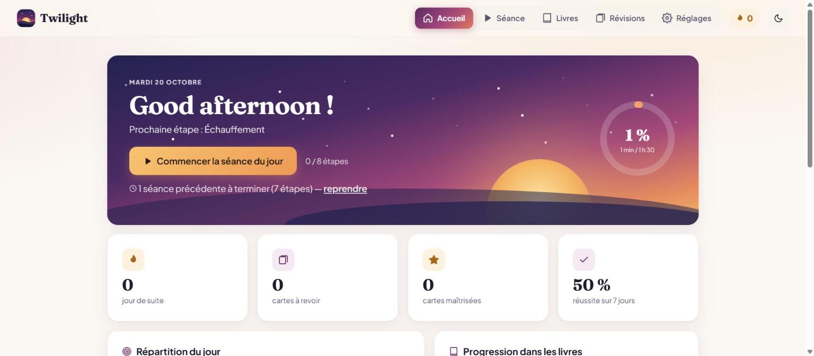
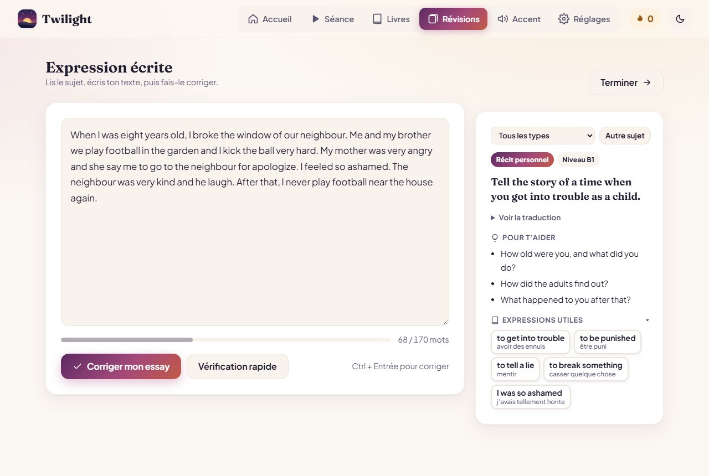
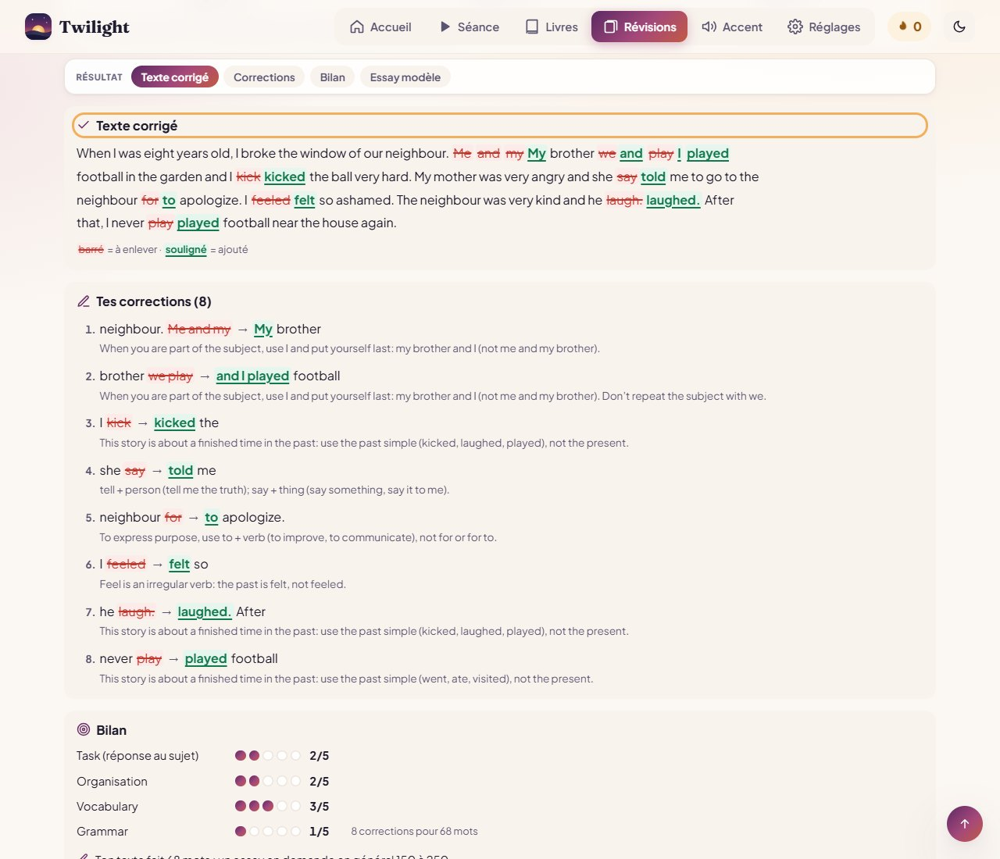
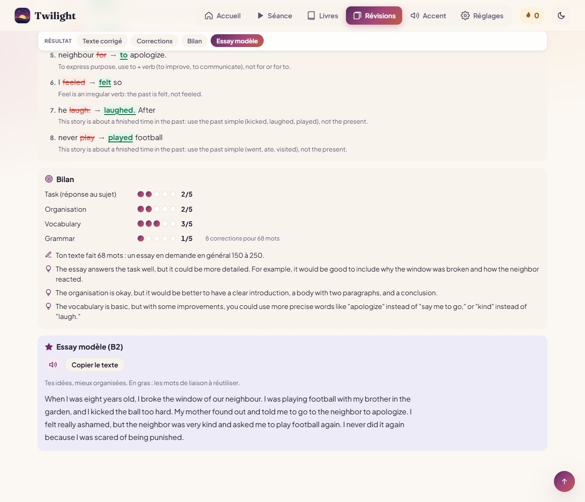
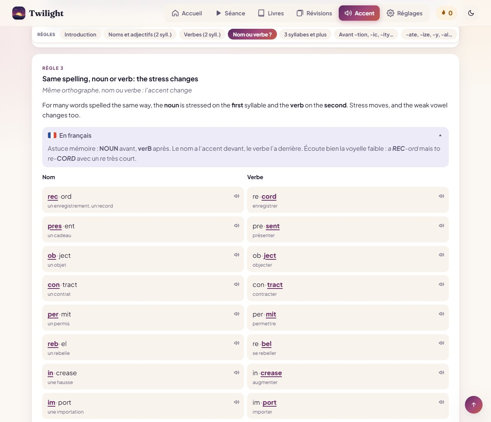
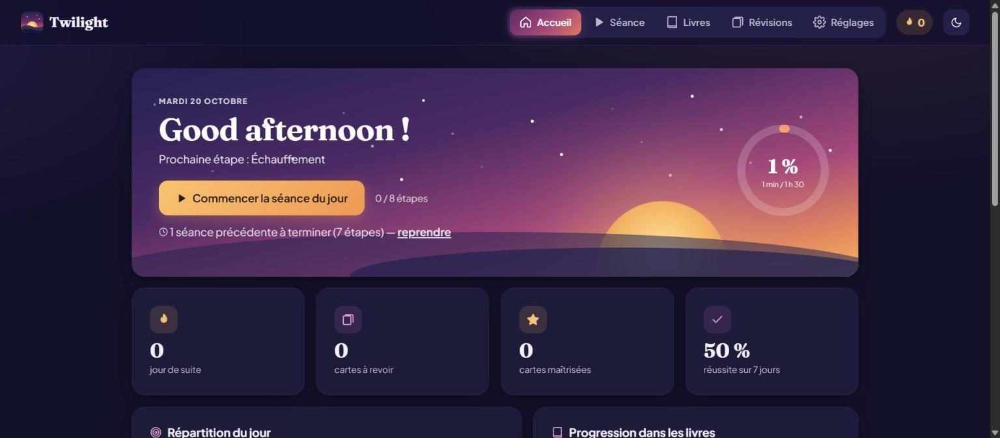
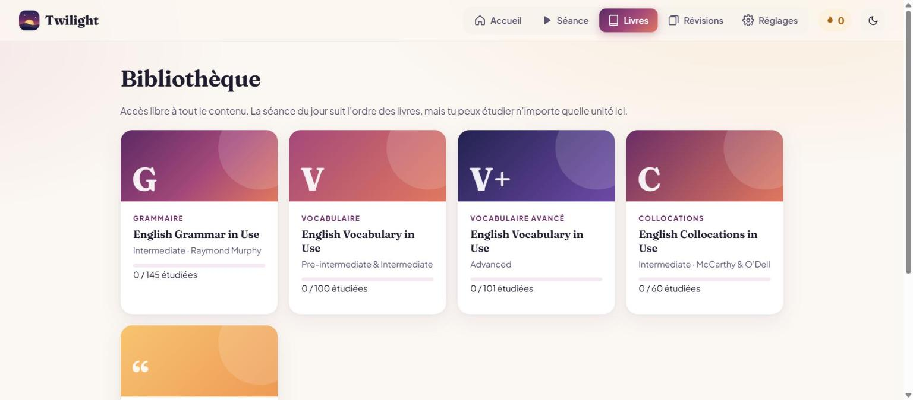

<div align="center">


# Twilight

**An offline-first web app to learn English — short lessons, retrieval practice, spaced-repetition flashcards, listening, pronunciation, word stress and an essay coach that runs on your own computer. Designed for French speakers.**

[](CHANGELOG.md)
[](LICENSE)
[](https://nodejs.org)


[What's new](#whats-new-in-110) · [Features](#features) · [Quick start](#quick-start) · [Local AI coach](#local-ai-essay-coach) · [Content](#content) · [Scripts](#scripts) · [Contributing](#contributing) · [License](#license)

🇫🇷 Guide d'utilisation en français : [LISEZMOI.md](LISEZMOI.md)

<br>



</div>

Twilight runs entirely on your own computer: a tiny Node.js server with no dependencies, a SQLite database for your progress, and a Progressive Web App that keeps working without internet — natural text-to-speech, speech recognition, grammar checking and the optional AI coach included. No account, no tracking, no cloud.

## What's new in 1.1.0

- **Essay writing, redesigned** — 150 original writing tasks, the task always visible next to the editor, a length meter, automatic drafts and one clear « Corriger mon essay » action.
- **Local AI essay coach** — a small language model on your CPU corrects your essay, scores it, gives three tips and writes a B2 model answer. A checked rule layer brings correction from ~60 % to ~94 % of mistakes in our tests and explains every correction.
- **Word stress** — a new section with 14 rules and their exceptions, ~280 words to listen to, a quiz, and a 10-word exercise in the daily session.
- **Clearer exercises** — every exercise has its own instruction (English + French) and French translations of difficult words and of the full sentence.
- **Spoken encouragement**, sticky in-page anchors on long pages, and colours checked against **WCAG AA** contrast in both themes.

See the full [changelog](CHANGELOG.md).

## Screenshots

| Essay writing | AI correction |
|:---:|:---:|
|  |  |
| **AI feedback and model essay** | **Word stress** |
|  |  |
| **Dark theme** | **Library** |
|  |  |

---

## Features

### A daily session built on learning research
- **90 minutes by default** (configurable), split according to research on effective learning ([Dunlosky et al., 2013](https://doi.org/10.1177/1529100612453266); [Roediger & Karpicke, 2006](https://doi.org/10.1111/j.1467-9280.2006.01693.x); [Cepeda et al., 2006](https://doi.org/10.1037/0033-2909.132.3.354)):
  - **40 % spaced-repetition flashcards** (SM-2), in short batches of 50; production cards unlock once a card is known;
  - **40 % exercises** with immediate feedback — mistakes come back sooner;
  - **20 % short lessons**, always followed by practice, with a recap before each set of exercises.
- **Interleaving**: grammar, vocabulary, collocation, idiom and phrasal-verb units alternate; review exercises mix past units.
- **Catch-up sessions**: unfinished sessions from the last 14 days can be resumed.
- **Daily reminders** (Windows): a notification at the time you choose if today's session isn't finished.

### Exercises
- **Six types**: multiple choice, gap fill, free writing, error correction, word order and matching, with tolerant checking (contractions, punctuation, near-misses) and valid alternative answers.
- **Clear instructions and French help**: each exercise has its own instruction in English and French, difficult words are translated (never the answer), and the full sentence is translated after you answer.
- **Spoken encouragement** in a cheerful voice (*"Incredible! You're worth it!"*), gentler after a mistake — can be turned off.
- **Original SVG illustrations** for collocations, idioms and phrasal verbs, drawn in the browser.

### Listening, speaking and word stress
- **Dictations and "what did you hear?"** read by an offline [Piper](https://github.com/rhasspy/piper) American voice (WebAssembly), with a slow mode.
- **Pronunciation practice** scored by [Vosk](https://alphacephei.com/vosk/) speech recognition running in the browser, with unlimited retries.
- **Word stress**: 14 rules with their exceptions (two-syllable nouns and verbs, *REcord / reCORD*, stress-moving suffixes, compounds, *-teen / -ty*, American vs British), ~280 words to listen to and a quiz. The daily session adds a 10-word exercise where missed words come back first. Every word's stress was checked against the voice's phonemes, and forced where the voice was wrong.

### Writing
- **150 original writing tasks** — opinion essays, advantages and disadvantages, personal stories, emails to a friend and descriptions, at B1 and B2 level — each with three guiding questions, useful expressions with translations and a target length.
- **The task stays visible** next to the editor; a meter shows your length against the target; drafts are saved in the browser; changing task asks for confirmation before erasing your text.
- **Quick check** with the offline grammar checker [Harper](https://github.com/Automattic/harper) (WebAssembly).
- **Full correction** with the optional [local AI coach](#local-ai-essay-coach).

### Comfort and design
- **Offline-first**: a Service Worker caches the app, the lessons, the photos and the voice; progress syncs to SQLite when the server is back.
- **Progress tracking**: streak, time per method, mastered cards, success rate, per-unit scores; daily automatic database backups.
- **Sticky anchors** on long pages (lessons, books, proverbs, settings, results) and a back-to-top button.
- **Light and dark themes** with text colours checked against WCAG AA contrast (4.5:1), keyboard-friendly, visible focus, status announced to screen readers.

## Quick start

Requirements: **[Node.js](https://nodejs.org) 22.5 or newer** (Twilight uses the built-in `node:sqlite` module — no `npm install` needed).

```bash
git clone https://github.com/ALEMDJOU/Twilight.git
cd Twilight
npm run setup       # sample content + offline voice, speech recognition and grammar checker (~170 MB, once)
npm run setup:ai    # optional: local AI essay coach (~1.1 GB, Windows, resumable)
npm start           # → http://localhost:4317
```

On Windows you can also double-click **`Lancer Twilight.bat`**. Open the URL once while the server is running; afterwards the app also opens offline.

## Local AI essay coach

An optional coach that corrects and marks your essays **on your own computer**: [Qwen3-1.7B](https://huggingface.co/Qwen/Qwen3-1.7B) (Apache-2.0, Q4_K_M quantization, 1.1 GB) run by [llama.cpp](https://github.com/ggml-org/llama.cpp) on the CPU. No GPU and no internet needed.

**How it works**

1. **The app gives the task** (from `public/js/topics.js`); the AI receives it with its kind, guiding questions and target length.
2. **Strict correction** (low temperature, few-shot examples) — then a checked rule layer (`public/js/mistakes.js`) fixes the French calques the small model misses (*say me*, *I write you*, *watch the TV*, *more calm*, *the next Saturday*, *I organise* + future time, *since five years*…) and keeps your British or American spelling.
3. **The list of corrections is computed by the app** from a word-by-word diff, and each one is explained in English by checked rules — the model never writes grammar explanations, which were often wrong.
4. **Teacher feedback** (higher temperature): scores for task, organisation and vocabulary, an estimated CEFR level, three tips about your ideas and structure, and a B2 model answer of the same kind, with linking words highlighted, that you can listen to. The grammar score is computed from the number of corrections per 100 words.

**Measured on an Intel i5-7200U laptop with 8 GB of RAM**

| | Result |
|---|---|
| Mistakes corrected (4 essays, 32 known mistakes) | model alone ~60 % · with the rule layer **~94 %** |
| Rule layer precision | 0 changes on 97 correct test sentences |
| Time per essay | about 1 min 30 to 2 min (first run: +30 s to load the model) |
| Memory while in use | about 2.2 GB, freed after 10 idle minutes |

The engine starts only when you ask, on a free local port, and stops after 10 idle minutes. Scores and the model answer come from a small model: treat them as guidance.

## Content

Twilight is a learning **engine**. Copyrighted course books are **not** included, and neither are the lessons derived from them. The repository ships original content — a sample in [`samples/content/`](samples/content), the 150 writing tasks and the word-stress section — so the app runs out of the box.

To study your own material, add units in `public/content/` (git-ignored):

```
public/content/
├── catalog.json        # list of units per book: { "grammar": [{ "n": 1, "title": "…", "section": "…" }], … }
├── proverbs.json       # { "items": [{ "n", "en", "meaning", "example", "fr" }] }
├── images.json         # generated by `npm run images` (photo credits)
├── index.json          # generated by `npm run check`
└── units/
    └── g1.json         # one file per unit: <book code><number>.json
```

Book codes: `g` grammar · `vi` vocabulary (intermediate) · `va` vocabulary (advanced) · `co` collocations · `id` idioms · `ip` idioms & phrasal verbs.

A unit looks like this (see [`samples/content/units/g1.json`](samples/content/units/g1.json) for a complete example):

```jsonc
{
  "book": "grammar", "n": 1,
  "titleFr": "Le présent continu",
  "goal": "Utiliser **am / is / are + -ing** …",
  "sections": [{ "id": "A", "title": "Form", "en": "…", "table": { "head": [], "rows": [] }, "examples": [{ "en": "…", "fr": "…" }], "tip": "…" }],
  "remember": ["…"],
  "exercises": [
    { "t": "mcq",   "q": "He ___ a shower.", "o": ["is having", "has"], "a": 0, "why": "…",
      "instr": "Choose the correct form: present continuous or present simple?",
      "instrFr": "Choisis la bonne forme : présent continu ou présent simple ?",
      "gloss": [["a shower", "une douche"]], "trFr": "Il prend une douche." },
    { "t": "gap",   "q": "Listen! Somebody ___ the piano.", "a": ["is playing"] },
    { "t": "write", "q": "Make a question: you / work / today?", "a": ["Are you working today?"] },
    { "t": "fix",   "q": "They is waiting.", "a": ["They are waiting."] },
    { "t": "order", "a": ["She isn't listening to me."], "words": ["listening", "She", "me.", "isn't", "to"] },
    { "t": "match", "pairs": [["left", "right"]] }
  ],
  "cards": [{ "en": "at the moment", "fr": "en ce moment", "pic": "⏱️", "img": "Clock" }]
}
```

Optional exercise fields: `instr` / `instrFr` (instruction in English and French — a default is used otherwise), `gloss` (`[english, french]` pairs for words visible in the question — never the answer), `trFr` (French translation of the full correct sentence, shown after answering), `hint`, `ctx`, `why`.

Rich text supports `**bold**`, `*italic*`, `==highlight==` and `~~wrong form~~`. Add `"img": "<English Wikipedia article title>"` to a card and run `npm run images` to download a free photo with its credits. Then validate everything with `npm run check`.

## Scripts

| Command | Description |
|---|---|
| `npm start` | Start the local server on port 4317 (`PORT` to change it, `--no-open` to skip opening the browser) |
| `npm run setup` | Install the sample content (if `public/content` is empty) and the offline engines |
| `npm run setup:voice` | Download the offline engines — Piper voice, Vosk speech recognition, Harper grammar checker (checksums verified) |
| `npm run setup:ai` | Optional: download llama.cpp and the Qwen3-1.7B model into `models/` (~1.1 GB, resumable, checksums verified) |
| `npm run check` | Validate the units and regenerate `public/content/index.json` |
| `npm run images` | Download Wikimedia Commons photos for cards that have an `img` field |

## Project structure

```
Twilight/
├── server.js               # static server + REST API (/api/progress, /api/reminder, /api/ai)
├── db.js                   # SQLite storage (node:sqlite) and daily backups
├── ai.js                   # local AI coach: starts/stops llama-server on demand, prompts, streaming
├── models/                 # llama.cpp + GGUF model from `npm run setup:ai` (git-ignored)
├── public/
│   ├── index.html
│   ├── sw.js               # Service Worker (offline cache)
│   ├── css/                # style.css (design tokens, light & dark themes), writing.css
│   ├── js/
│   │   ├── app.js          # router and app shell
│   │   ├── store.js        # local-first state, sync with the server
│   │   ├── srs.js          # SM-2 spaced repetition
│   │   ├── session.js      # daily plan (40/40/20), catch-up sessions
│   │   ├── components.js   # lessons, exercises, flashcards, spoken praise
│   │   ├── scenes.js       # original SVG illustrations
│   │   ├── check.js        # answer checking
│   │   ├── tts.js, piper.js# text-to-speech (Piper + system voices)
│   │   ├── listening.js    # dictation, listening and pronunciation (speech.js = Vosk)
│   │   ├── writing.js      # essay writing page (Harper quick check)
│   │   ├── coach.js        # AI correction results (progress steps, corrections, feedback, model essay)
│   │   ├── mistakes.js     # checked fixes and explanations of typical French-speaker mistakes
│   │   ├── topics.js       # 150 original writing tasks
│   │   ├── stress-data.js  # word stress rules, exceptions and words (original content)
│   │   └── views/          # dashboard, session, library, review, stress, settings
│   └── fonts/              # self-hosted fonts (OFL)
├── docs/screenshots/       # images used in this README
├── samples/content/        # original sample content
├── tools/                  # content validation, downloads (fetch-voice.js, fetch-ai.js), daily reminder
└── data/                   # your progress (git-ignored)
```

## Privacy

Everything stays on your machine. The app makes no network request at runtime — the setup scripts are the only ones that download anything. Your progress lives in `data/twilight.db` (with daily copies in `data/backups/`) and in your browser; your essays are sent only to the AI engine running on your own computer. Use *Réglages → Exporter* to save a JSON copy.

## Contributing

Issues and pull requests are welcome.

1. Fork the repository and create a branch: `git checkout -b feature/my-change`.
2. Keep the code dependency-free (vanilla ES modules, no build step) and offline-first.
3. Run `npm run check` if you touch the content tools, and test with the server both running and stopped.
4. For correction rules, add a wrong sentence that must be fixed and correct sentences that must stay unchanged.
5. Never commit copyrighted book material, personal data (`data/`) or downloaded assets (`public/vendor/`, `models/`).

## License

Twilight's source code is released under the [MIT License](LICENSE). Third-party components keep their own licenses — see [THIRD_PARTY_NOTICES.md](THIRD_PARTY_NOTICES.md).

*English Grammar in Use*, *English Vocabulary in Use*, *English Collocations in Use* and *English Idioms in Use* are trademarks of Cambridge University Press. Twilight is an independent project, not affiliated with or endorsed by Cambridge University Press.
